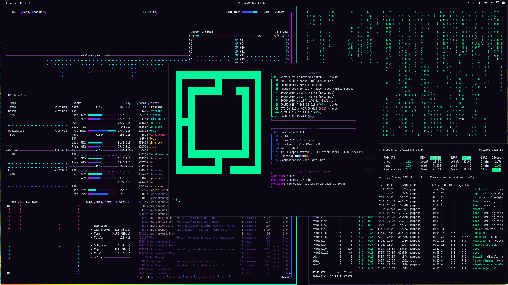
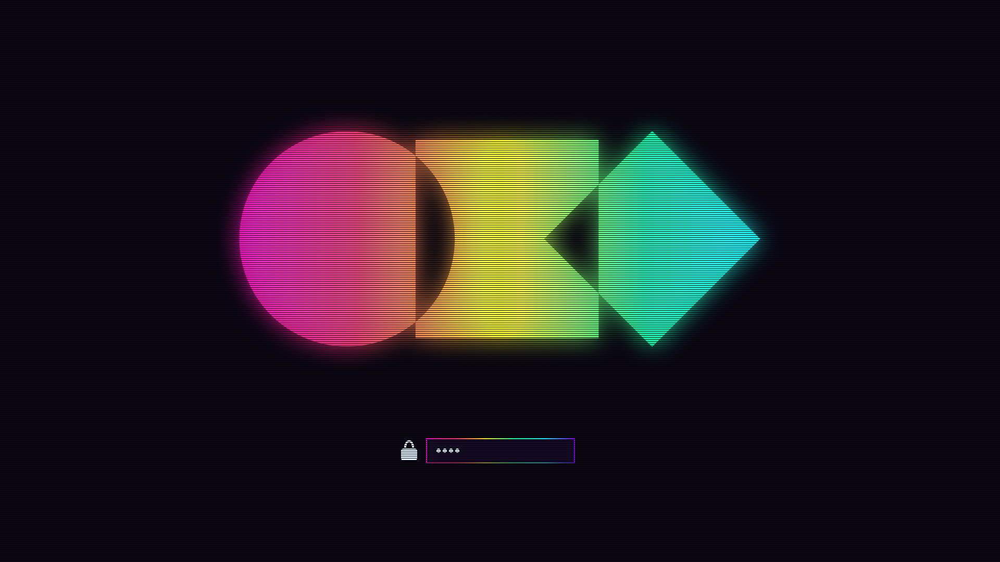
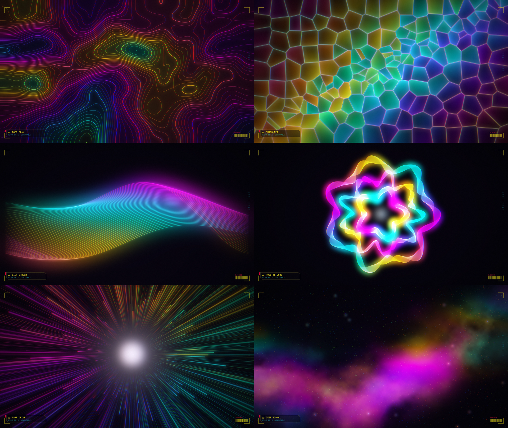

# Spectral

Spectral: the full neon spectrum on a near-black base. A cyberpunk theme for [Omarchy](https://omarchy.org) with an acid-yellow accent, a full-spectrum gradient on every window border, and a set of 4K wallpapers plus seamless live loops made for it.



## Install

```bash
omarchy-theme-install https://github.com/qempexe/omarchy-spectral-theme
```

Cycle wallpapers (stills and live loops) with `omarchy-theme-bg-next`.

## Highlights

- Window borders, notifications, menus, launcher, popups and the lock screen share a magenta → red → yellow → green → cyan → violet gradient
- Acid-yellow accent over a near-black base
- Gradient lock and boot logo
- Every wallpaper carries a subtle angular HUD



## Wallpapers



| # | Name | |
|---|------|---|
| 01 | contours | glowing topographic scan |
| 02 | crystal | stained-glass shards with lit seams |
| 03 | silk | flowing light ribbons |
| 04 | rosette | layered guilloche line work |
| 05 | tunnel | spectral warp streaks |
| 06 | nebula | spectrum clouds and stars |

### Live

Seamless 8-second loops (1080p, 30 fps). Omarchy plays them as animated backgrounds when cycled to.

| # | Name | |
|---|------|---|
| 07 | live-warp | continuous warp jump |
| 08 | live-silk | ribbons in constant motion |

## Palette

| | | | |
|---|---|---|---|
| background `#0a0612` | foreground `#e0f7ff` | accent `#fcee0a` | selection `#3d0a6b` |
| red `#ff2a6d` | orange `#ff7b00` | yellow `#fcee0a` | green `#00ff9f` |
| cyan `#00f0ff` | blue `#2d5bff` | magenta `#d300ff` | pink `#ff4fe0` |
